# Visual servoing

Overview of the visual control interface for the EXTENDER project.

Updated on: 10/19/2026

Prerequisites:
* USB or built-in camera (visible in “/dev/video”)
* Ubuntu 24.04
* ROS2 Jazzy
* EXTENDER ISIR project packages: 
  * `/tools/extender_msgs`
  * `/tools/apriltag_detector`
  * `bloom` (optional)
* your own package that publishes on the following topics:
  * "visual_servoing: clear" => `/ui/visual_servoing/clear` `Type: std_msgs/msg/String`
  * "visual_servoing: On" => `/ui/visual_servoing/on` `Type: std_msgs/msg/Bool`
  * "visual_servoing: save" => `/ui/visual_servoing/save`  `Type: std_msgs/msg/String`

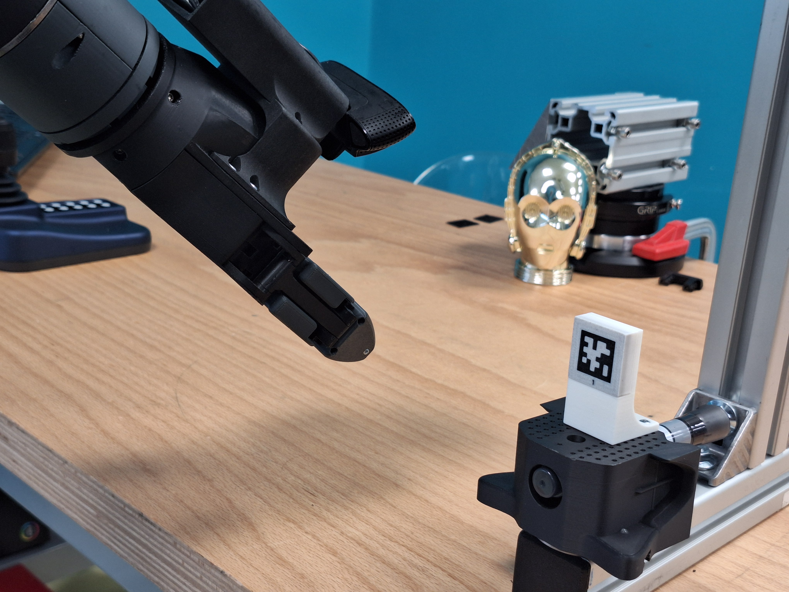

## Install
As part of the Extender project at ISIR, all the necessary packages are installed via “extender_workspace”. However, if this is not the case or if you want to use "visual_servoing" for our own project, here are the links to download and clone all necessary packages :

[visual_servoing](https://github.com/ISIR-EXTENDER/input_interfaces) package: <https://github.com/ISIR-EXTENDER/input_interfaces.git>

[“apriltag_detector”](https://github.com/ISIR-EXTENDER/tools/tree/main/apriltag_detector) and [“extender_msgs”](https://github.com/ISIR-EXTENDER/tools/tree/main/extender_msgs) packages: <https://github.com/ISIR-EXTENDER/tools.git>

*Optional :*

[bloom](https://github.com/ISIR-EXTENDER/bloom) package: <https://github.com/ISIR-EXTENDER/bloom.git>

Command lines : 
```bash
cd ~/workspace_ws/src/
git clone https://github.com/ISIR-EXTENDER/input_interfaces
git clone https://github.com/ISIR-EXTENDER/tools.git
git clone https://github.com/technodroide/ros2_handeye_calibration.git
```
*Optional :*
```bash
git clone https://github.com/ISIR-EXTENDER/bloom.git
```
Rebuild your ros2 workspace:
```bash
cd ~/workspace_ws
source /opt/ros/jazzy/setup.bash
source install/setup.bash
colcon build --symlink-install --packages-select apriltage_detector extender_msgs visual_servoing ros2_handeye_calibration
```

You should now have this architecture :
```bash
# HOST ~
tree -d -L 2 explorer_devenv/ 
# extender_workspace/
# ├── some other folders
# └── src
#     ├── input_interfaces
#         └── visual_servoing
#     └── tools
#         ├── extender_msgs
#         └── apriltag_detector
```
## Architecture

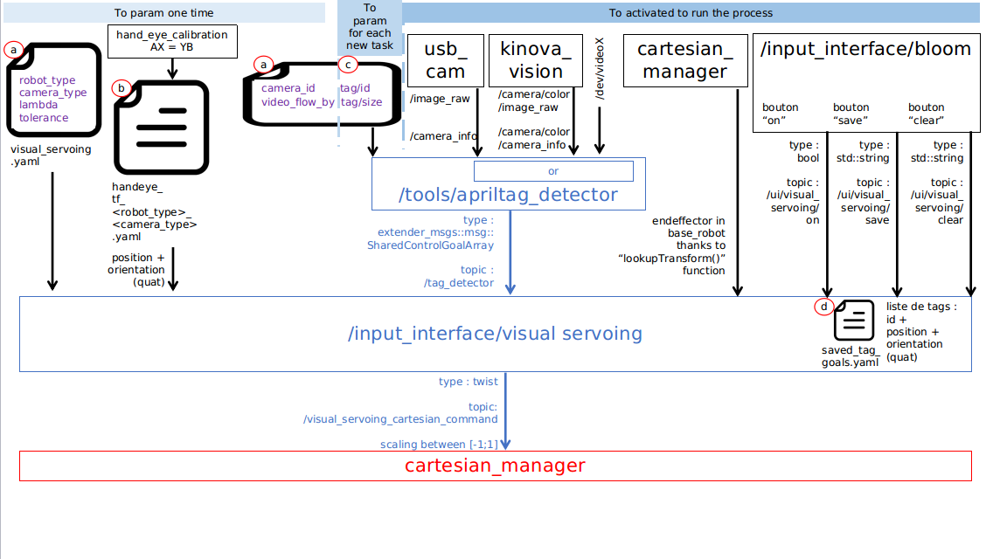

*Caption:*
* "hand_eye_calibration" = package used to estimate the camera transformation relative to the gripper coordinate system

* “usb_cam” = a node that returns the camera flow from a USB camera via two topics (‘camera_info’ and “image_raw”)
ros2 run usb_cam usb_cam_node_exe --ros-args -p video_device:=/dev/video0

* “kinova_vision” = a node that returns the camera flow from a USB camera via two topics (‘camera_info’ and “image_raw”)
ros2 launch kinova_vision kinova_vision.launch.py

* "cartesian_manager" = your controller node; it returns the transformation tree (TF), including the end-effector coordinate in the robot’s base

* "/input_interface/bloom" = web interface used here to publish on three topics, represented as buttons. You can use your own package to publish to these same three topics.

## Configuration
The configuration phase allows you to specify all the information the robot needs to perform the desired visual servoing action. This includes:

* in “apriltag_detector”:
  * the size of the AprilTag
  * the number of the camera being used
  * the type of video flow being used (open_cv, usb_cam, kinova_vision)
* in “visual_servoing”:
  * the type of camera used (camera_usb, camera_kinova)
  * the type of robot used (kinova, explorer)
  * the transformation between the gripper coordinate system and the camera coordinate system
  * the storage of the position(s) of the AprilTag relative to the manipulated object
* the servo position(s) that the robot must achieve relative to the tagged object.

### a/ Configuring the device (one-time setup)
First, you can specify the type of camera and robot being used. 
This allows you to select the correct “YAML” file for the transformation between the robot's gripper and the camera.

Configuration files are named as follows: 
`handeye_tf_<robot_type>_<camera_type>.yaml`

Here are some examples of filenames that include the camera type and robot type in their titles :
* `handeye_tf_explorer_camera_usb.yaml`
* `handeye_tf_kinova_camera_kinova.yaml`
* `handeye_tf_kinova_camera_usb`

So, to get the correct configuration file, we need to specify the camera type and robot type in the `visual_servoing` package :
`~/workspace_ws/src/input_interfaces/visual_servoing/config/visual_servoing.yaml`
```yaml
visual_servoing:
  ros__parameters:
    camera_type: <to_complet>
    robot_type: <to_complet>
```
Here are a few examples of camera types that could be specified :
| USB camera | Kinova camera | Realsense D435i | OAK-D |
| :---: | :---: | :---: | :---: |
| 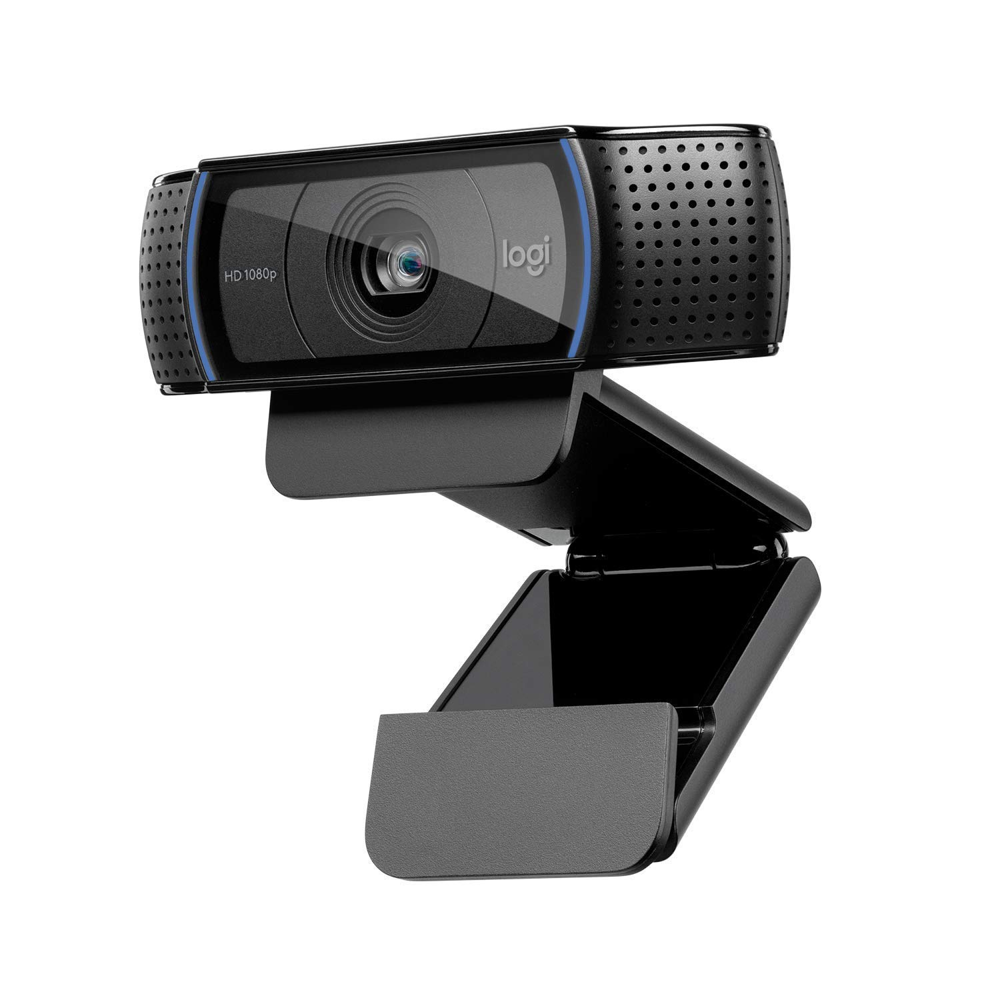 | 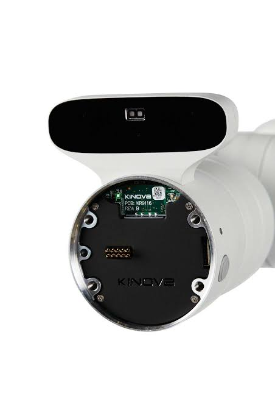 | 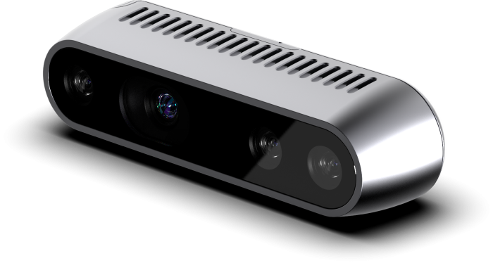 |  |
| `camera_type: "camera_usb"` | `camera_type: "camera_kinova"` | `camera_type: "camera_realsense_d435i"` | `camera_type: "camera_oak_d"` |

Here are a few examples of robots types that could be specified :
| Kinova gen3 7dof | Explorer |
| :---: | :---: |
| 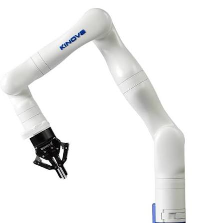 | 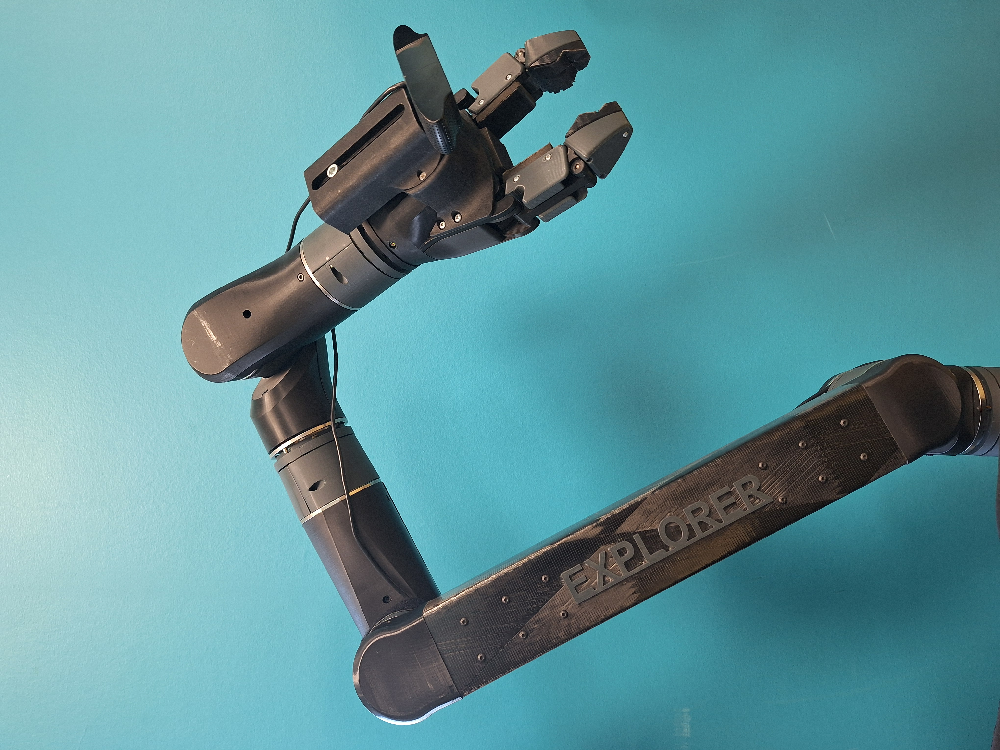 |
| `robot_type: “kinova”` | `robot_type: “explorer”` |

This time in `tools/apriltag_detector` package, you must also specify the type of video flow to be processed:

`~/workspace_ws/src/tools/apriltag_detector/config/tags_params.yaml`
```yaml
apriltag_detector:
   ros__parameters:
      video_flow_by: <to_complet>
      camera_id: <to_complet>
```

| USB camera ROS node | Kinova Vision ROS node | Open CV |
| :---: | :---: | :---: |
|  |  |  |
| `video_flow_by: “usb_cam”` | `video_flow_by: "kinova_vision"` | `video_flow_by: "open_cv"` |

Here, you have two options:
* via a ROS node :

  In this case, launch the node in a terminal that publishes the `“/camera_info”` and `“/info_raw”` topics from our camera.
  For example:
    * for `video_flow_by: “kinova_vision”`:
      ```bash
      ros2 launch kinova_vision kinova_vision.launch.py
      ```
    * for `video_flow_by: “usb_cam”`:
      ```bash
      ros2 run usb_cam usb_cam_node_exe --ros-args -p video_device:=/dev/video0
      ```
  The `“/camera_info”` and `“/info_raw”` topics currently in use are as follows:
  ```yaml
  apriltag_detector:
     ros__parameters:
        …
        topic_kinova_vision_camera_info: “/camera/color/camera_info”
        topic_kinova_vision_image_raw: “/camera/color/image_raw”
        topic_usb_cam_camera_info: “/camera_info”
        topic_usb_cam_image_raw: “/image_raw”
  ```
* via Open CV `video_flow_by: “open_cv”` :

  In this case, you must specify the number of the camera you are using in the `apriltag_detector` configuration file.
  To view the available video flow, run the following command in a terminal:
  ```bash
  ~$ ls /dev/video*
  ```
  You should see an output similar to the line below:
  ```bash
  /dev/video0  /dev/video1
  ```

  If you have multiple cameras connected to your system, repeat the process after unplugging the camera you want to use for Apriltag detection.
  This will help you identify the /dev/videoX used by the camera.
  It’s possible that two /dev/videoX entries are used by the same camera. In this case, test one and then the other if you encounter an error reading the camera flow when launching apriltag_detector.

  Once you’ve identified the camera flow used by your camera, enter the flow number in the `apriltag_detector` configuration file:
  `~/workspace_ws/src/tools/apriltag_detector/config/tags_params.yaml`

  Here's an example :
  
  ```yaml
  apriltag_detector:
     ros__parameters:
        video_flow_by: “open_cv”
        camera_id: 0  // For this example, if the flow comes from /dev/video0, enter “0”
  ```
### b/ Calculation of the transformation between the gripper's frame and the robot's camera frame (one-time calibration)

A calibration package named “[handeye_calibration](https://github.com/giuschio/ros2_handeye_calibration)” allows you to enter the information needed to perform the transformation between the camera frame and the robot gripper’s frame.

To do this, install the package: <https://github.com/giuschio/ros2_handeye_calibration>
```bash
cd ~/workspace_ws/src/
git clone https://github.com/giuschio/ros2_handeye_calibration
cd ~/workspace_ws
colcon build --packages-select hand_eye_calibration
```

This package uses the TF tree to estimate the transform from the camera coordinate system to the gripper coordinate system. To do this, it needs to know the names of the coordinate systems used in the transform tree:

* the camera coordinate system (camera_link)
* the robot base coordinate system (base_link)
* the robot gripper coordinate system (“end_effector_link” or “tool0”)
* the camera location (“eye-on-hand” or “eye-in-hand”)

To specify the correct expected names, configure this information in a launch file dedicated to the robot/camera pair you are using:
* File location :
`~/workspace_ws/src/ros2_handeye_calibration/launch/calibration_<robot_name>_<camera_name>.launch.py`
* Example of settings :
```python
tracking_base_frame = DeclareLaunchArgument('tracking_base_frame', default_value="camera_link",
description="e.g. camera frame")
    tracking_marker_frame = DeclareLaunchArgument('tracking_marker_frame',
default_value="tag_4")
    robot_base_frame = DeclareLaunchArgument('robot_base_frame',
default_value="base_link")
    robot_effector_frame = DeclareLaunchArgument('robot_effector_frame',
default_value="tool0")
    calibration_type = DeclareLaunchArgument('calibration_type',
default_value="eye-in-hand",
description="Options are eye-in-hand or eye-on-base")
```

Calibration is now ready to begin with package `hand_eye_calibration`:
1. Securely mount the camera on the robot’s gripper.
2. Print an AprilTag with an ID that matches the tag number specified in the `launch` file mentioned earlier, and with a size correctly configured in `apriltag_detector/config/tag_parameters` (recommended minimum size: 48mm × 48mm)
3. Attach the marker to a stationary surface within the camera’s field of view.
4. Launch the `cartesian_manager` and `apriltag_detector` nodes:

    Terminal 1: ```bash ros2 launch cartesian_manager explorer.launch.py ```

    Terminal 2: ```bash ros2 launch apriltag_detector apriltag_detector.launch.py ```

    Verify that the robot publishes the transformation between its base and its gripper in TF.
    Verify that the AprilTag detector publishes the transformation between the camera and the marker.

5. Launch the “hand_eye_calibration” package:
    Terminal 3: ```bash ros2 launch hand_eye_calibration calibration_<robot_name>_<camera_name>.launch.py```
6. Collect measurements to perform the sampling:

    Terminal 4: ```bash ros2 service call /hand_eye_calibration/capture_point std_srvs/srv/Trigger {}```

    Then reposition the robot while keeping the tag within the camera’s field of view to perform a new recording.
    Tips:
    a. The robot must be completely stationary when the measurement is taken.
    b. Aim for a variety of measurements where the robot’s position and orientation change significantly.
    c. Take measurements with the camera positioned fairly far from the tag.
    d. Record at least 3 samples to perform the estimation.It is recommended that you make 15 of them.

7. Get the values of the estimated transformation in the terminal:
`[hand_eye_calibration]: transform: tx, ty, tz, qx, qy, qz, qw: [-0.0321, 0.0260, 0.0786, 0.6105, -0.5911, 0.3772, -0.3683]`

    Place the values in a “.yaml” file dedicated to this robot/camera pair in the “visual_servoing” config folder:
    `~/workspace_ws/src/input_interfaces/visual_servoing/config/handeye_tf_<robot_type>_<camera_type>.yaml`

    Contents of the configuration file:
    ```yaml
    %YAML:1.0
    ee_frame: tool0         // “tool0” for Explorer, or “end_effector_link” for Kinova Gen3
    camera_frame: camera_link
    tx: -0.0321
    ty: 0.000
    tz: 0.0786
    qx: 0.6105
    qy: -0.5911
    qz: 0.3772
    ```
    Be sure to enter the same `robot_type` and `camera_type` values as those previously specified in the `visual_servoing` configuration file so that they are properly taken into account.


### c/ Configuring the apriltags used (must be done for each new task)
The effectiveness of the tracking depends on the position and size of the Apriltag in the camera's return image:
* the larger and more centered the Apriltag is in the image
* the more successful the detection will be.

Here are two examples: one with a small tag that is poorly positioned within the camera’s field of view, and the other with a tag that is well-positioned, large, and centered within the camera’s field of view.

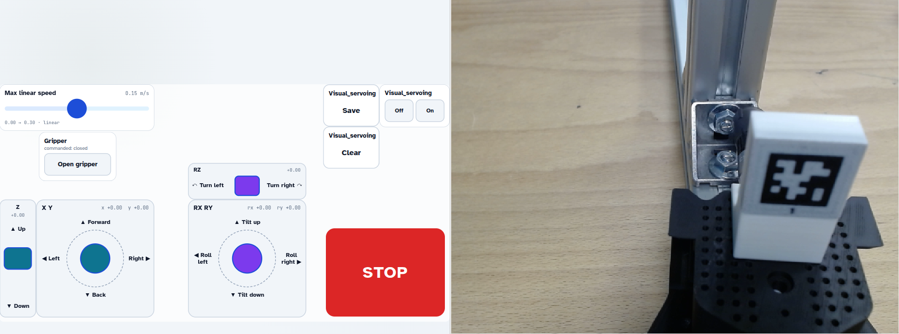
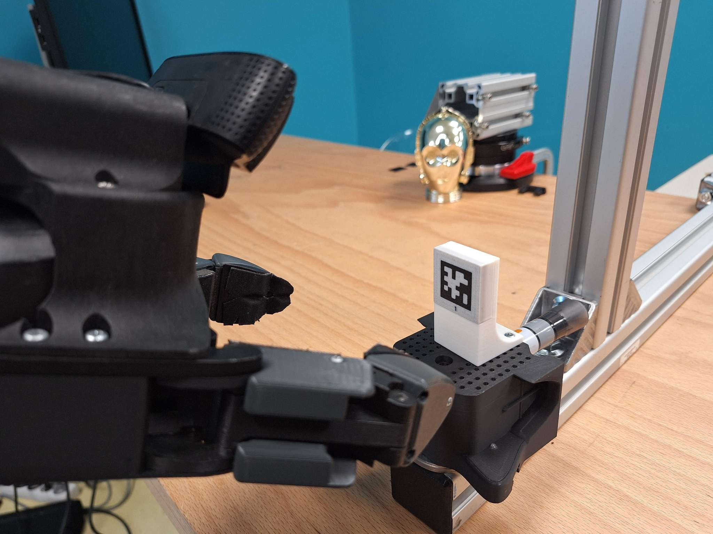
<div align="center">

*figure : incorrect placement of the tag*

</div>
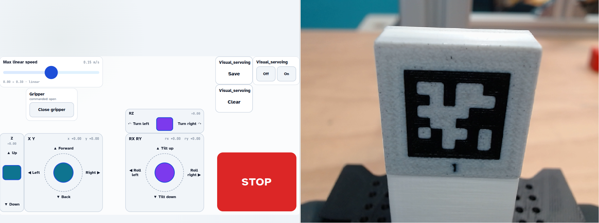
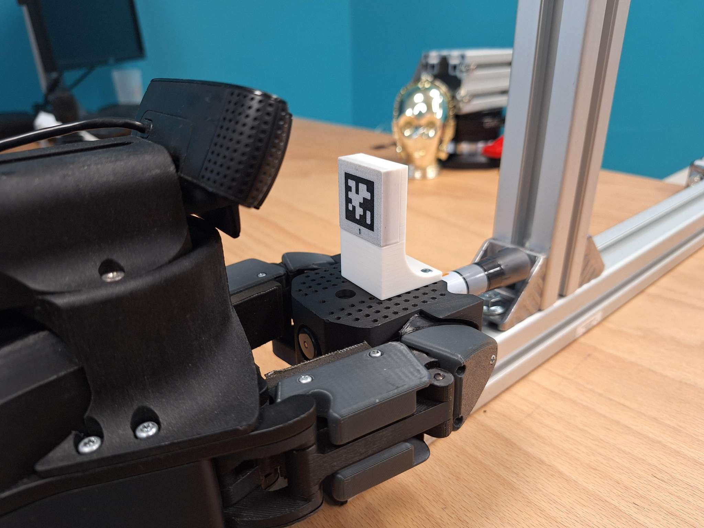
<div align="center">

  *figure : correct placement of the tag*

</div>
To determine the size and location of the appropriate Apriltag for your scenario, place the robot’s gripper in its grasping/inspection position with the object to be tagged.


Using the Apriltags you have, choose:
* a location where the camera can see it
* a tag size that fills a large portion of the camera’s field of view
* with an ID that is different from those used in other scenarios you may have used in the past

Once selected, attach the tag to the designated location.
Make a note of the tag’s ID.

Now, you can specify the size of the tag used in the configuration file:

`~/workspace_ws/src/tools/apriltag_detector/config/tags_params.yaml`

For example, for a tag with ID “5” and a size of “0.075” meters:
```yaml
apriltag_detector:
  ros__parameters:
    tag_sizes:
      “5”: 0.075
```

### d/ Recording positions and execution (to be done for each new task)

Once you have selected and set the apriltag you want to use for your scenario, you can follow the procedure to teach the robot position(s) to move, based on the position of the object it will interact with.

For example, here we will set up a scenario for picking up a tool holder.

We’re ready to start recording. The sequence will be recorded in reverse, meaning we’ll start at the final position and move further and further away from the object until we reach the robot’s starting position before it interacts with the object


1. First, position the robot’s gripper so that it is ready to interact with the object in question. Here, we’re gripping the tool holder.

   If the previous step was performed correctly, the tag should be visible in the camera’s field of view and in close-up.

    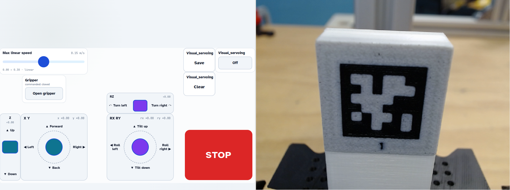
    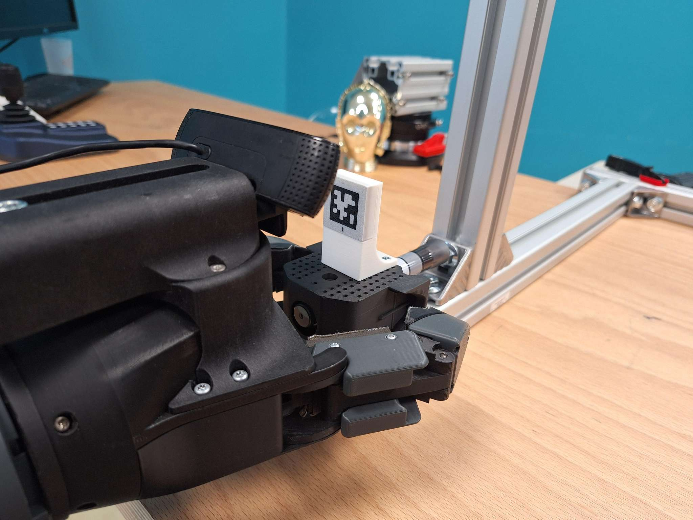

   To ensure that no previous positions have been saved with this tag ID, press the “visual_servoing: clear” button once.

    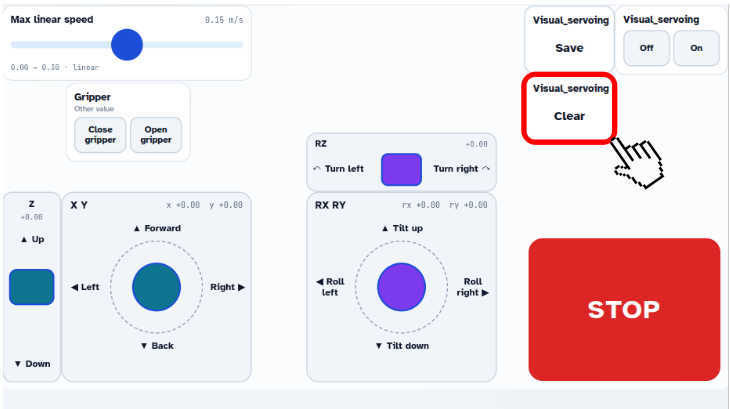

2. On the web interface or in your own devise, capture the image read by the camera using the “visual_servoing: save” button.

    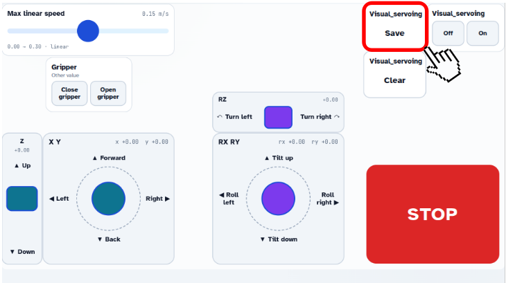

3. Move the gripper slightly away from the tool holder/object, make sure the tag is fully visible in the image, and then save this new image using the “visual_servoing: save” button.
    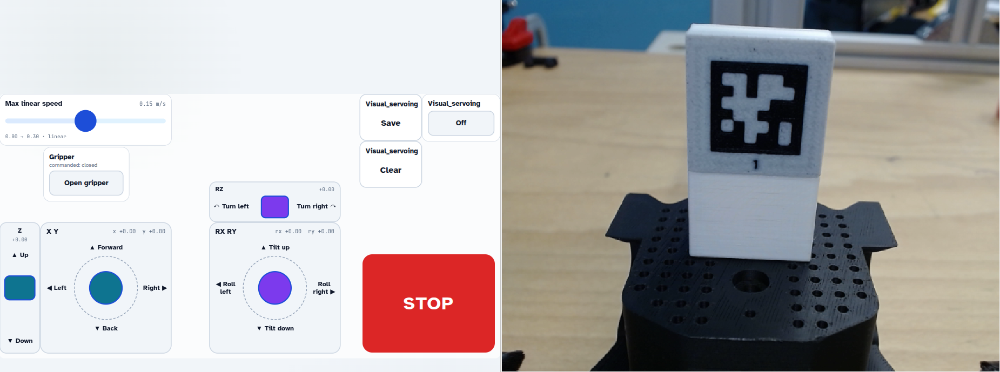
    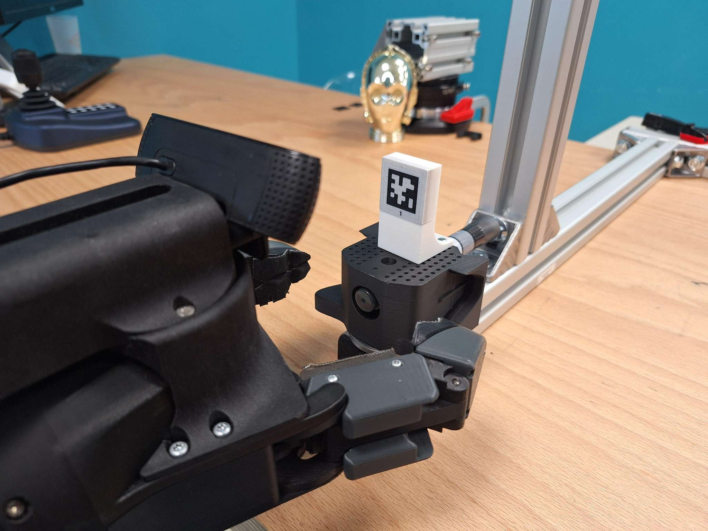

4. If necessary, move the gripper away from the tool holder/object a second time to create a new intermediate position.
    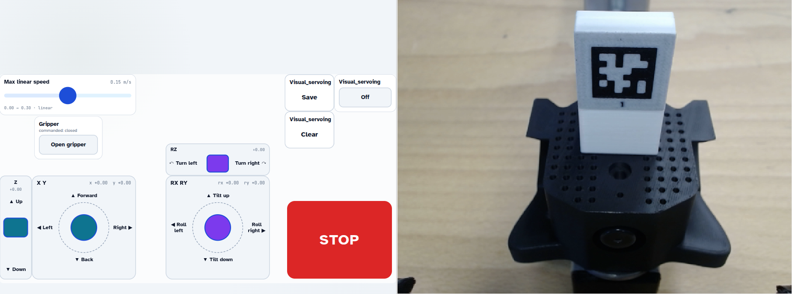
    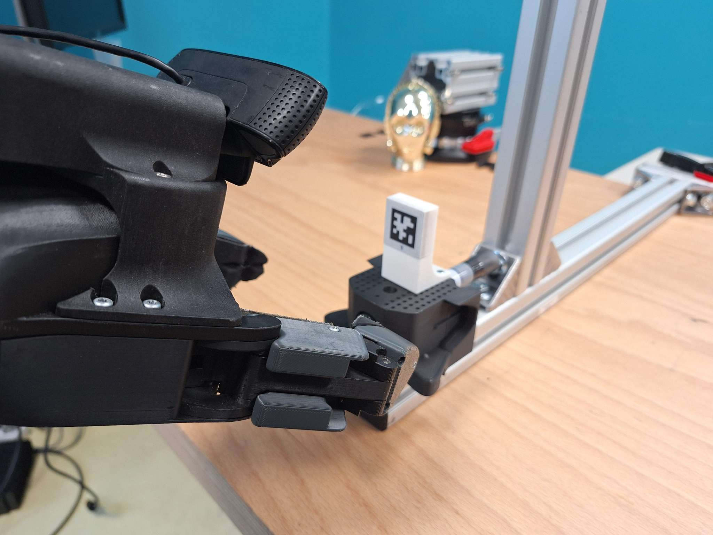

5. That’s it—you’ve now learned the entire approach sequence for the robot to grasp the tool holder/object equipped with the Apriltag. To verify, run the sequence with “visual_servoing: On.” The robot will perform the learned sequence and remain in servo mode at the last position in the list.

    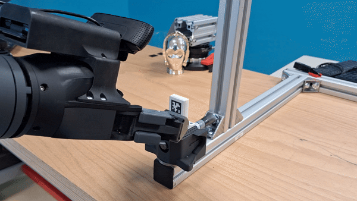

6. Once the final position is reached and/or if you wish to stop servo mode, click “visual_servoing: On” again.

## Summary
To configure the settings, you need to fill in the following settings :

`src/visual_servoing/config/visual_servoing.yaml`
```yaml
visual_servoing:
  ros__parameters:
    camera_type: “<to_complet>”           // “camera_usb” or “camera_kinova” or “camera_oak”
    robot_type: “<to_complet>”            // “kinova” or “explorer”
```
`src/tools/apriltag_detector/config/tags_params.yaml`
```yaml
apriltag_detector:
  ros__parameters:
    camera_id: <to_complet>               // use “ls /dev/video*” to identify the source of the video flow
    video_flow_by: <to_complet>           // “open_cv” or “usb_cam” or “kinova_vision”
    tag_sizes:
      “<your_tag_id>”: <size_of_tag_id>   // Enter the numbers of the tags used and their size in meters
```

handeye_tf_<robot_type>_<camera_type>.yaml :
```yaml
%YAML:1.0
---
ee_frame: “<to_complet>”                  // “tool0” for Explorer, or “end_effector_link” for Kinova Gen3
camera_frame: camera_link

tx: <to_complet>                          // to be completed based on “hand_eye_calibration” estimation
ty: <to_complet>                          // to be completed based on “hand_eye_calibration” estimation
tz: <to_complet>                          // to be completed based on “hand_eye_calibration” estimation

qx: <to_complet>                          // to be completed based on “hand_eye_calibration” estimation
qy: <to_complet>                          // to be completed based on “hand_eye_calibration” estimation
qz: <to_complet>                          // to be completed based on “hand_eye_calibration” estimation
qw: <to_complet>                          // to be completed based on “hand_eye_calibration” estimation
```

The output topic from the package that returns the robot gripper's velocities in the robot database :

`Name: /visual_servoing_cartesian_command`

`Type: geometry_msgs/msg/TwistStamped`
